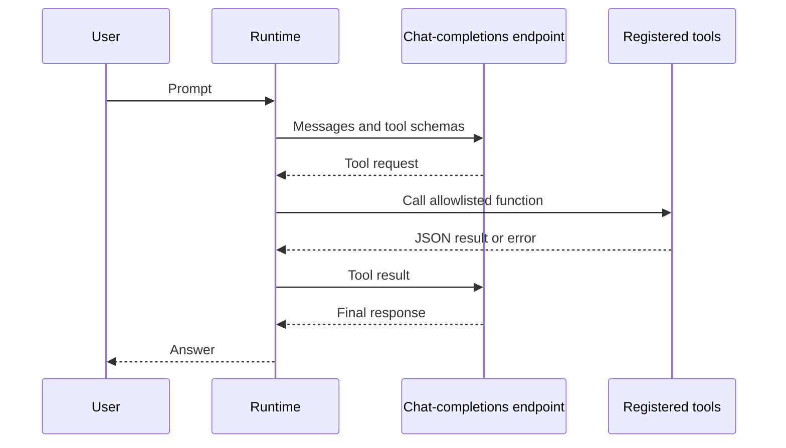

# Zafin AI OS

<p align="center">
  <strong>A small, inspectable runtime for model-guided tool use.</strong><br />
  Start locally, then connect an OpenAI-compatible chat-completions endpoint.
</p>

<p align="center">
  <a href="https://github.com/Skeeb32/Zafin-AI-os"></a>
  
  
</p>

Zafin AI OS is an early agent-runtime project. Its first milestone implements a bounded request loop: a model can ask for an explicitly registered tool, the runtime executes that tool, and the result is returned to the model for a final response.

The repository does **not** yet implement persistent memory, RAG, dynamic model routing, sandboxed code execution, or cloud deployment.

## What works today

- **Bounded tool loop:** caps how many tool rounds a model can request.
- **Explicit tool allowlist:** the model can invoke only functions registered by the application; it cannot send arbitrary code to a shell.
- **OpenAI-compatible provider:** sends chat-completions requests using Python's standard library.
- **Offline demo:** demonstrates a tool call without an API key or external service.
- **Small Python core:** no runtime dependencies; requires Python 3.11 or newer.
- **Automated checks:** standard-library unit tests, with a GitHub Actions workflow configured for Python 3.11 and 3.12.

## How a run works



## Quick start

### Requirements

- Python 3.11 or newer
- An API key for a compatible model endpoint if you want to run a live request

### Install

```bash
git clone https://github.com/Skeeb32/Zafin-AI-os.git
cd Zafin-AI-os
python -m venv .venv
source .venv/bin/activate
python -m pip install -e .
```

### Run the offline demo

```bash
zafin-os --demo
```

The demo model requests the registered `add` tool and prints a final response. It uses a scripted model response, so it does not evaluate the prompt or contact a model provider.

You can also run it from the source tree without installing the package:

```bash
PYTHONPATH=src python -m zafin_os --demo
```

### Connect a model endpoint

Set the API key, model name, and (optionally) API base URL in your environment:

```bash
export ZAFIN_AI_API_KEY="your-api-key"
export ZAFIN_AI_MODEL="your-model-name"
# Optional. Defaults to https://api.openai.com/v1
export ZAFIN_AI_BASE_URL="https://api.openai.com/v1"
zafin-os "Add 20 and 22, then explain the result."
```

The base URL may be a service root, a `/v1` URL, or a full `/chat/completions` URL. Provider-specific authentication or request formats may require an adapter; compatibility depends on the endpoint's chat-completions and tool-calling behavior.

## Add a tool

Register application functions with a JSON Schema parameter definition. Only registered functions are exposed to the model:

```python
from zafin_os import AgentRuntime, ToolRegistry
from zafin_os.providers import OpenAICompatibleProvider

tools = ToolRegistry()
tools.register(
    name="add",
    description="Add two numbers.",
    parameters={
        "type": "object",
        "properties": {
            "left": {"type": "number"},
            "right": {"type": "number"},
        },
        "required": ["left", "right"],
        "additionalProperties": False,
    },
    handler=lambda left, right: left + right,
)

model = OpenAICompatibleProvider(
    base_url="https://api.openai.com/v1",
    model="gpt-4o-mini",
    api_key="read-this-from-your-environment",
)
answer = AgentRuntime(model, tools, max_steps=8).run("What is 20 plus 22?")
print(answer)
```

Tool functions execute inside the Python process with the permissions of that process. Register only functions that are safe for your application to expose. The runtime currently has no separate sandbox or permission system.

## Project layout

```text
.github/workflows/tests.yml
tests/
├── test_providers.py
└── test_runtime.py
src/zafin_os/
├── cli.py        # Command line setup and built-in add tool
├── demo.py       # Offline scripted model
├── providers.py  # OpenAI-compatible HTTP client
└── runtime.py    # Agent loop, message types, and tool registry
```

## Tests

Run the unit suite from the repository root:

```bash
PYTHONPATH=src python -m unittest discover -s tests -v
```

The suite covers tool registration and errors, bounded runtime execution, provider URL handling, request construction, response parsing, and HTTP error reporting. It uses mocked HTTP responses and does not require API credentials or network access.

## Roadmap

- [x] Bounded model/tool execution loop
- [x] Explicit tool registration
- [x] OpenAI-compatible chat-completions adapter
- [x] Offline demo with no credentials
- [x] Add focused automated tests for tool calls, limits, and provider responses
- [x] Configure a GitHub Actions workflow for Python 3.11 and 3.12
- [ ] Add provider configuration and model routing
- [ ] Add persistent run state and a documented memory interface
- [ ] Explore retrieval with source citations
- [ ] Add structured events and evaluation hooks
- [ ] Design stronger isolation before supporting untrusted code execution

Items without a checkmark are plans, not available features.

## Contributing

Issues and pull requests are welcome. For changes to runtime behavior, include a short description of the use case and the expected tool or model interaction. Security-sensitive changes should explain the trust boundary and failure behavior.

## For engineers

This first milestone demonstrates a compact Python runtime, a provider boundary, explicit tool registration, JSON-based tool results, and a bounded execution loop. It is an early foundation, not a production agent platform: automated tests, persistence, observability, model routing, and execution isolation remain to be built.

## Follow the project

If you find this direction useful, [watch the repository](https://github.com/Skeeb32/Zafin-AI-os) for updates. Contributions that help make the runtime easier to inspect, test, and secure are welcome.
