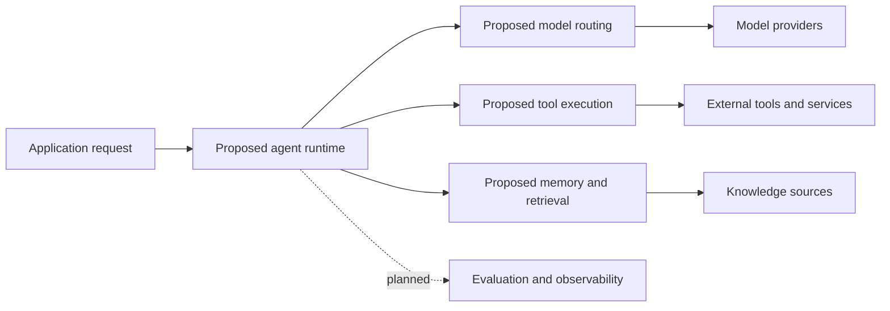

# Zafin AI OS

<p align="center">
  <strong>An open project exploring the foundations of an AI operating system.</strong><br />
  A proposed direction for coordinating agents, models, memory, and tools.
</p>

<p align="center">
  <a href="https://github.com/Skeeb32/Zafin-AI-os"></a>
  
</p>

> **Project status:** Planning. The repository currently contains no implementation, dependencies, tests, or deployment configuration. This README describes a possible project direction; the capabilities below are proposed and are not available yet.

## What this project aims to explore

AI applications often combine models, tools, retrieval, and application code without a clear runtime boundary. **Zafin AI OS** is a proposed project to explore how those parts could fit together in a modular, inspectable system.

The initial direction is to investigate:

- Agent task orchestration and execution
- Model selection and routing
- Persistent state and retrieval-augmented generation (RAG)
- Controlled tool use and code execution
- Evaluation, observability, and operational safeguards

These are goals for future development, not claims about the current repository.

## Proposed system map

The diagram is a conceptual starting point. It does not represent implemented components or verified interfaces.



## Current capabilities

There are no runnable capabilities to list yet. The repository has no source tree or project configuration. The sections below describe candidate milestones and will be updated as code is added and verified.

## Roadmap

Proposed milestones, subject to design and implementation:

- [ ] Define the project scope, supported use cases, and security boundaries
- [ ] Choose an initial language, runtime, and dependency strategy
- [ ] Implement a small, testable request and tool-execution path
- [ ] Add model-provider interfaces and configuration examples
- [ ] Explore persistent memory and retrieval with documented data flows
- [ ] Add evaluation and operational visibility for implemented behavior
- [ ] Document deployment options after a working local setup exists

## Getting started

The repository has no application code yet, so there is currently nothing to install or run. You can clone it to follow development:

```bash
git clone https://github.com/Skeeb32/Zafin-AI-os.git
cd Zafin-AI-os
```

Once the first runnable milestone is available, this section should include verified prerequisites, setup steps, environment variables, run commands, and test commands.

## Technology

No language, framework, database, model provider, or deployment platform has been selected in the repository yet. Technology badges and setup instructions will be added after those choices are reflected in code and configuration.

## Contributing

Contributions will be easier to review once the project has an initial implementation and contribution guidelines. If you are interested in shaping the direction, open a GitHub issue describing the use case or design question you would like the project to address.

Before proposing production or security claims, tie them to working code, tests, and documented behavior.

## For engineers and recruiters

At this stage, this repository demonstrates an early project concept only. It does not yet demonstrate agent orchestration, RAG, model routing, sandboxing, cloud deployment, or production operations. Those areas may become useful engineering milestones if they are implemented and validated.

## Follow the project

If this direction is useful to you, [watch the repository](https://github.com/Skeeb32/Zafin-AI-os) for updates. When implementation begins, the README will be revised to show working examples, architecture grounded in the code, and verified setup instructions.
